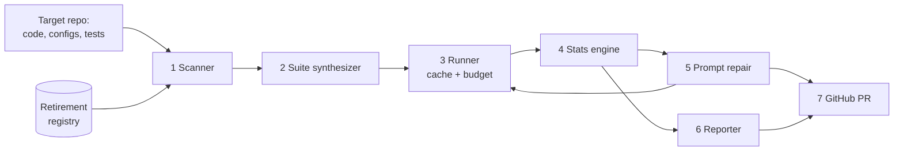

# Architecture overview

ModelBump is a pipeline of independent stages. Each stage has one job, a typed input and a typed output, so stages can be tested, evaluated and replaced on their own.

| Stage | Responsibility | Status |
|-------|----------------|--------|
| [Registry](registry.md) | Which model IDs are retired, and when | v1 (Phase 1) |
| [Scanner](scanner.md) | Find model IDs in code and config; match them against retirement dates | v0.1.0 (Phase 2) |
| [Suite synthesizer](synth.md) | Build regression test cases and oracles from the target repo | v0.4.0 (Phase 5) |
| [Oracles](oracles.md) | Decide whether each answer still does the job, by output type | v0.4.0 (Phase 5) |
| [Suites](suite.md) | Write the suite file and run it on two models (`modelbump test`) | v0.4.0 (Phase 5) |
| [Runner](runner.md) | Call models with caching, retries and a cost budget | Done (Phase 3) |
| [Stats engine](stats.md) | Decide REGRESSED / IMPROVED / EQUIVALENT / INCONCLUSIVE per test case | v0.3.0 (Phase 4) |
| [Prompt repair](repair.md) | Find prompt edits that fix regressions safely | Patches (Phase 6, in progress) |
| Reporter / GitHub | Produce reports and open the upgrade PR | Planned (Phase 7) |

Each stage gets its own page here when it is built.
