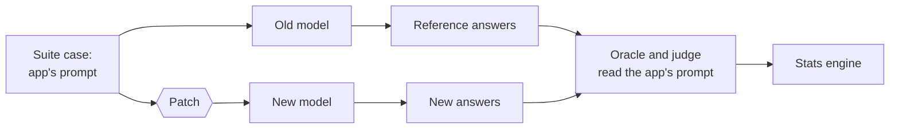

# Prompt repair

When a case REGRESSED after a model change, the fix is often in the prompt: the new model needs an instruction the old one did not. Prompt repair finds and tests such fixes. Phase 6 builds it in steps; this page grows with each one.

## Patches

A patch is a fix to the prompt of one LLM call ([ADR 0062](../adr/0062-prompt-patches.md)). It is a JSON file:

```json
{
  "version": 1,
  "patches": [
    {
      "call": "support.py:24",
      "edits": [
        {"find": "Answer with one label", "replace": "Answer with exactly one label"}
      ],
      "add_system": "Reply with the label only: one word, no punctuation.",
      "note": "Qwen 3 adds an explanation after the label."
    }
  ]
}
```

- `call` is the `path:line` from the case ids (`support.py:24#1`), and the patch applies to every case of that call.
- Each `find` must occur exactly once in every case, so with two or more cases it can only match the prompt the developer wrote, never one case's inputs.
- `add_system` goes at the end of the system message, or becomes a new system message when the call has none.
- `note` is for people; no model sees it.

Check what a patch changes before spending any answers on it:

```console
$ modelbump repair show demo-suite.json patch.json
--- support.py:24#1 (app)
+++ support.py:24#1 (patched)
@@ -1,6 +1,8 @@
 [system]
 You sort support tickets.
-Answer with one label: bug, feature, question.
+Answer with exactly one label: bug, feature, question.
+
+Reply with the label only: one word, no punctuation.
 [user]
 Ticket:
 The app crashes when I log in.
...
The patch changes 3 test cases in 1 LLM call.
```

Then test it:

```console
$ modelbump test demo-suite.json --from ollama/qwen2.5:7b --to ollama/qwen3:8b --to-think none --patch patch.json
Compared ollama/qwen2.5:7b -> ollama/qwen3:8b on 5 test cases, 3 patched for the new model: fixed k=50 + BH ...
```

The lines above only show the format; the verdicts depend on the models.

## What a patch can and cannot change



Only the new model sees the patched prompt. The reference answers, the oracle and the judge all use the app's own prompt, so a patch passes only if the new model still does the original job. A patch that makes the task easier ("answer bug to everything") fails the same checks as any other wrong answer.
