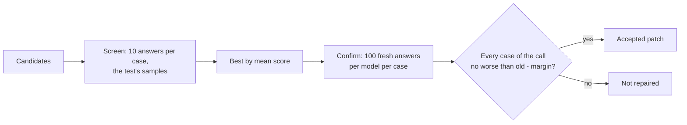
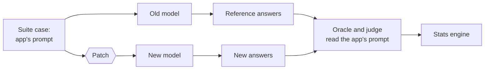

# Prompt repair

When a case REGRESSED after a model change, the fix is often in the prompt: the new model needs an instruction the old one did not. Prompt repair finds and tests such fixes. Phase 6 builds it in steps; this page grows with each one.

## Patches

A patch is a fix to the prompt of one LLM call ([ADR 0062](../adr/0062-prompt-patches.md)). It is a JSON file:

```json
{
  "version": 1,
  "patches": [
    {
      "call": "support.py:24",
      "edits": [
        {"find": "Answer with one label", "replace": "Answer with exactly one label"}
      ],
      "add_system": "Reply with the label only: one word, no punctuation.",
      "note": "Qwen 3 adds an explanation after the label."
    }
  ]
}
```

- `call` is the `path:line` from the case ids (`support.py:24#1`), and the patch applies to every case of that call.
- Each `find` must occur exactly once in every case, so with two or more cases it can only match the prompt the developer wrote, never one case's inputs.
- `add_system` goes at the end of the system message, or becomes a new system message when the call has none.
- `note` is for people; no model sees it.

Check what a patch changes before spending any answers on it:

```console
$ modelbump repair show demo-suite.json patch.json
--- support.py:24#1 (app)
+++ support.py:24#1 (patched)
@@ -1,6 +1,8 @@
 [system]
 You sort support tickets.
-Answer with one label: bug, feature, question.
+Answer with exactly one label: bug, feature, question.
+
+Reply with the label only: one word, no punctuation.
 [user]
 Ticket:
 The app crashes when I log in.
...
The patch changes 3 test cases in 1 LLM call.
```

Then test it:

```console
$ modelbump test demo-suite.json --from ollama/qwen2.5:7b --to ollama/qwen3:8b --to-think none --patch patch.json
Compared ollama/qwen2.5:7b -> ollama/qwen3:8b on 5 test cases, 3 patched for the new model: fixed k=50 + BH ...
```

The lines above only show the format; the verdicts depend on the models.

## Candidate patches from a model

`modelbump repair propose` asks a local model to write candidate patches for every call with a REGRESSED case ([ADR 0063](../adr/0063-candidate-patches-from-a-local-model.md)). It reads the suite and a JSON report of an unpatched run:

```console
$ modelbump test demo-suite.json --from ollama/qwen2.5:7b --to ollama/qwen3:8b --to-think none --format json --output report.json
$ modelbump repair propose demo-suite.json report.json --candidates 5
support.py:24: 3 candidates, 2 refused
  sample 1 refused: the same as sample 0
  sample 3 refused: does not fit the suite: case support.py:24#1: 'Could you add a dark mode?' is found 0 times; an edit must match exactly once
Wrote 3 candidate patches for 1 call to modelbump-proposals.
```

The lines above only show the format. The proposer (`--model`, default `ollama/gemma3:12b`) sees the app's prompt, the old model's reference answer, and up to three failing new answers with the checks they failed. Each answer becomes a candidate only if it is a valid patch that fits the suite; the others are listed with the reason. A call with a single test case gets `add_system` candidates only, because there an edit could change the input without anyone noticing.

Each candidate is an ordinary patch file (`modelbump-proposals/support.py-24.00.json`), so `repair show` and `test --patch` work on it as they are. `proposals.json` in the same folder lists every candidate with the proposer's one-line reason, and every refused answer. Proposing does not say a candidate works: that is the repair loop's job.

## The repair loop

`modelbump repair run` decides which candidates to keep ([ADR 0064](../adr/0064-repair-loop-screen-then-confirm.md)):

```console
$ modelbump repair run demo-suite.json modelbump-proposals --from ollama/qwen2.5:7b --to ollama/qwen3:8b --to-think none
Repair ollama/qwen2.5:7b -> ollama/qwen3:8b: screen each candidate on 10 runs, confirm the best candidate on 100 fresh runs (alpha 0.05, margin 0.10), free text judged by ollama/gemma3:12b.
REPAIRED      support.py:24  (3 test cases)
              screen: old 1.00, unpatched new 0.67
                support.py-24.02.json: new 1.00
                support.py-24.00.json: new 0.70
              confirm support.py-24.02.json: accepted
                support.py:24#1: old 100/100, patched new 99/100, lower bound -0.05 > -0.10
                support.py:24#2: old 100/100, patched new 100/100, lower bound -0.04 > -0.10
                support.py:24#3: old 98/100, patched new 99/100, lower bound -0.05 > -0.10
Result: 1 of 1 call repaired.
Wrote the accepted patches to modelbump-repair.json.
```

The lines above only show the format.



**The guarantee, per call:** the chance of accepting a patch that leaves any test case of the call more than `--margin` worse than the old model is at most about `--alpha`. Picking the best candidate on the screening answers cannot inflate this, because the confirming answers are fresh draws. Every case has to pass on its own, so a case that a patch breaks counts as much as the case it fixes. The guarantee covers the inputs in the suite, so a call with more test cases gets a stronger check.

| Option | Default | What it does |
|--------|---------|--------------|
| `--screen-runs` | 10 | Answers per case for each candidate when screening. |
| `--confirm-runs` | 100 | Fresh answers per model per case to confirm. Fewer can only accept cases both models almost always pass. |
| `--confirm-top` | 1 | Candidates to confirm per call, each at alpha divided by this number. |
| `--alpha`, `--margin` | 0.05, 0.10 | The guarantee's chance and how much worse still counts as fine. |
| `--output` | `modelbump-repair.json` | Patch file with the accepted patches, for `modelbump test --patch`. |
| `--report` | none | Also write every screen and confirmation as JSON. |

`--from-think`, `--to-think`, `--judge`, `--no-judge`, `--reference`, `--temperature`, `--max-tokens` and `--budget-requests` work as in `modelbump test`. Use the same values as the test that found the regression, so its answers come from the cache.

## What a patch can and cannot change



Only the new model sees the patched prompt. The reference answers, the oracle and the judge all use the app's own prompt, so a patch passes only if the new model still does the original job. A patch that makes the task easier ("answer bug to everything") fails the same checks as any other wrong answer.
