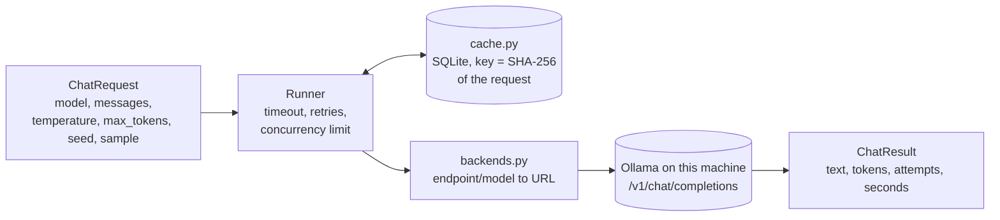

# Runner

**Job:** send prompts to models and get answers back, reliably and for free.

**Code:** `src/modelbump/runner/` · **Command:** `modelbump ask PROMPT --model ollama/qwen2.5:7b` · **Decisions:** [ADR 0036](../adr/0036-runner-speaks-openai-compatible-http.md), [ADR 0037](../adr/0037-response-cache-in-sqlite.md)

## What happens on a failure

| Failure | What the runner does |
|---------|----------------------|
| Timeout, connection refused | Wait, then try again |
| HTTP 408, 429, 500, 502, 503, 504 | Wait (at least `Retry-After`, up to 30 s), then try again |
| Any other HTTP error, e.g. 404 model not found | Stop at once with `RunnerError` |
| Still failing after the last attempt | Stop with `RunnerError`, saying why and how many attempts |

The wait before attempt *n* + 1 is a random time between 0 and min(30 s, 1 s × 2*n*−1). The randomness ("full jitter") stops many requests from retrying at the same moment.

## Endpoints

| Endpoint | URL | Key |
|----------|-----|-----|
| `ollama` | `http://localhost:11434/v1` (or `MODELBUMP_OLLAMA_URL`) | none |

Free API tiers come in a later step. ModelBump never needs a paid key.

## Cache

Every successful answer is stored under the SHA-256 hash of its request: the model, every message with its role, `temperature`, `max_tokens`, `seed` and `sample`. Asking the same thing again reads the stored answer (`cached=True`) instead of calling the model, so an experiment can be re-run for free and gives the same numbers. Failures are never stored.

| Command | What it does |
|---------|--------------|
| `modelbump ask PROMPT` | Uses the cache; prints `from cache` when it did |
| `modelbump ask PROMPT --no-cache` | Always calls the model |
| `modelbump ask PROMPT --sample 1` | A second, separately cached draw of the same request |
| `modelbump cache info` | Where the cache is, how many answers it holds |
| `modelbump cache clear` | Deletes every stored answer (asks first; `--yes` skips the question) |

The file is `~/.cache/modelbump/responses.sqlite` unless `MODELBUMP_CACHE_DIR` or `XDG_CACHE_HOME` is set.

## Coming next

- A budget limit on tokens.
