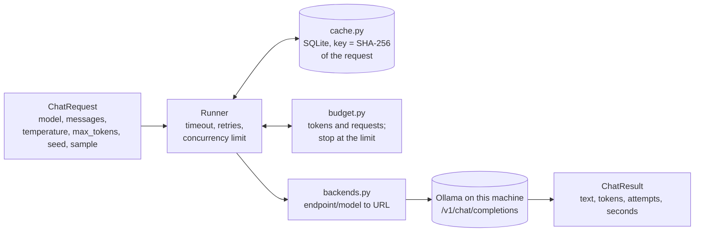

# Runner

**Job:** send prompts to models and get answers back, reliably and for free.

**Code:** `src/modelbump/runner/` · **Command:** `modelbump ask PROMPT --model ollama/qwen2.5:7b` · **Decisions:** [ADR 0036](../adr/0036-runner-speaks-openai-compatible-http.md), [ADR 0037](../adr/0037-response-cache-in-sqlite.md), [ADR 0038](../adr/0038-budget-in-tokens-and-requests.md), [ADR 0039](../adr/0039-pin-local-models-to-their-digest.md)



## What happens on a failure

| Failure | What the runner does |
|---------|----------------------|
| Timeout, connection refused | Wait, then try again |
| HTTP 408, 429, 500, 502, 503, 504 | Wait (at least `Retry-After`, up to 30 s), then try again |
| Any other HTTP error, e.g. 404 model not found | Stop at once with `RunnerError` |
| Still failing after the last attempt | Stop with `RunnerError`, saying why and how many attempts |

The wait before attempt *n* + 1 is a random time between 0 and min(30 s, 1 s × 2<sup>*n*−1</sup>). The randomness ("full jitter") stops many requests from retrying at the same moment.

## Endpoints

| Endpoint | URL | Key |
|----------|-----|-----|
| `ollama` | `http://localhost:11434/v1` (or `MODELBUMP_OLLAMA_URL`) | none |

Free API tiers come in a later step. ModelBump never needs a paid key.

## Local models

`modelbump models` lists what Ollama has pulled. Before sending, `modelbump ask` pins each `ollama/...` request to the model's digest (`model_version`), so a re-pulled model with new weights gets new cache entries, and a model that is not pulled stops with `Run: ollama pull NAME`.

```console
$ modelbump models
MODEL              PARAMS  QUANT    SIZE     DIGEST
ollama/qwen2.5:7b  7.6B    Q4_K_M   4.7 GB   845dbda0ea48
ollama/qwen3:8b    8.2B    Q4_K_M   5.2 GB   500a1f067a9f
```

Thinking models (Qwen 3 and newer) reason before answering. `--think none` turns that off, `low`/`medium`/`high` set how much, and leaving it out keeps the model's default. A `<think>` block at the start of an answer is removed from the text.

Candidate old → new pairs that fit a 16 GB laptop (one model is loaded at a time); the pairs used in the experiments are fixed later:

| Family | Old | New |
|--------|-----|-----|
| Qwen | `qwen2.5:7b` | `qwen3:8b` |
| Llama | `llama3:8b` | `llama3.1:8b` |
| Gemma | `gemma2:9b` | `gemma3:12b` |

## Cache

Every successful answer is stored under the SHA-256 hash of its request: the model, every message with its role, `temperature`, `max_tokens`, `seed` and `sample`. Asking the same thing again reads the stored answer (`cached=True`) instead of calling the model, so an experiment can be re-run for free and gives the same numbers. Failures are never stored.

| Command | What it does |
|---------|--------------|
| `modelbump ask PROMPT` | Uses the cache; prints `from cache` when it did |
| `modelbump ask PROMPT --no-cache` | Always calls the model |
| `modelbump ask PROMPT --sample 1` | A second, separately cached draw of the same request |
| `modelbump cache info` | Where the cache is, how many answers it holds |
| `modelbump cache clear` | Deletes every stored answer (asks first; `--yes` skips the question) |

The file is `~/.cache/modelbump/responses.sqlite` unless `MODELBUMP_CACHE_DIR` or `XDG_CACHE_HOME` is set.

## Budget

A `Budget` counts what a run uses and stops sending requests once a limit is reached. There are no dollars: every model is free, so the limits are **tokens** (in + out) and **requests** (retries included, because free tiers count every request). Cached answers cost nothing and are reported as savings.

```console
$ modelbump ask "Name a fruit." "Name a colour." "Name a city." --budget-requests 2
## Name a fruit.
Apple.
## Name a colour.
Blue.
## Name a city.
Error: Budget reached: 2 of 2 requests sent.
Spent: 2 requests, 70 tokens (60 in, 10 out). From cache: 0 answers (0 tokens saved). Budget used: 100% of 2 requests.
Answers so far are cached: run the same command with a higher limit to continue.
```

Running the same command again costs one request: the first two answers come from the cache.

The limit is checked before each request. Requests already in flight finish, so the token total can end slightly above the limit, by at most what those answers use.

## Coming next

- Free API tier endpoints, after checking their current limits.
