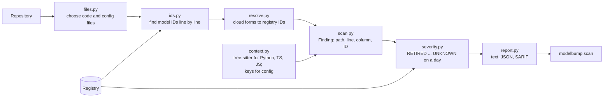

# Scanner

**Job:** answer "which LLM model IDs does this repository depend on, and where?"

**Code:** `src/modelbump/scanner/` · **Command:** `modelbump scan PATH` · **Decisions:** [ADR 0023](../adr/0023-scanner-finds-ids-as-text-first.md), [ADR 0024](../adr/0024-severity-levels-and-ci-exit-code.md), [ADR 0025](../adr/0025-json-and-sarif-reports.md), [ADR 0026](../adr/0026-github-action.md), [ADR 0027](../adr/0027-python-context-with-tree-sitter.md), [ADR 0028](../adr/0028-typescript-and-javascript-context.md)



## How an ID is recognised

Each line is split into runs of letters, digits, `.`, `-` and `_`. A run is a finding when it is:

| Rule | Example found | Example ignored |
|------|---------------|-----------------|
| An exact registry ID | `claude-3-haiku-20240307` | |
| A provider name with a digit (lowercase) | `gpt-4o`, `gemini-2.5-flash`, `o3-mini` | `gpt-tokenizer`, `GPT-4` |
| A plain-word registry ID, only when quoted | `engine="davinci"` | `Ada Lovelace` |
| The part after a provider prefix | `anthropic.claude-3-...`, `openai/gpt-4o` | `my-gpt-4o` |

Cloud forms are then mapped to the registry ID, but only when the mapped ID is in the registry: Bedrock's `claude-3-haiku-20240307-v1` becomes `claude-3-haiku-20240307`, and Vertex AI's `claude-3-5-sonnet@20240620` becomes `claude-3-5-sonnet-20240620`.

## Context

Each finding says where the ID sits, so a real use stands out from a mention:

| Context | Example | Text report shows |
|---------|---------|-------------------|
| `call_argument` | `client.messages.create(model="...")` | `[in client.messages.create(model=)]` |
| `call_argument` (TS/JS) | `openai.chat.completions.create({ model: "..." })` | `[in openai.chat.completions.create({model})]` |
| `assignment` | `MODEL = "..."`, `def ask(model="...")` | `[assigned to MODEL]` |
| `string` | `{"model": "..."}`, `["..."]` | `[value of model]` for a dict value |
| `docstring` | `"""Uses gpt-4o."""` | `[in a docstring]` |
| `comment` | `# was gpt-4o` | `[in a comment]` |
| `config` | `summary_model: ...` in YAML | `[value of summary_model]` |
| `text` | files without a parser yet (notebooks, Go, Java, ...) | nothing |
| `prose` | `"Model to use (default: ...)"`, help and log text | `[in a sentence]` |
| `table` | `"...": (2.50, 10.00)`, `'...': 200000` (prices, token limits) | `[key of a price or limit table]` |

Python, TypeScript and JavaScript are parsed with tree-sitter, so files with syntax errors or Python 2 code still get context. In TS/JS, a value in an options object passed to a call counts as a call argument, and fallbacks such as `process.env.MODEL ?? "..."` count as the assignment they feed. Three line rules then mark IDs that only describe a model ([ADR 0031](../adr/0031-describing-contexts-and-test-files.md)): a whole-line comment in a file without a parser (`//` in Go, `#` in YAML or `.env`) is a `comment`; an ID inside a one-line string with spaces is `prose`, unless the string holds code (`\"gpt-4o\"` in a notebook, or `model='gpt-4o'` inside a JSON string in a saved flow); and a string key followed by a number is a `table`. `--skip-comments` leaves out `comment`, `docstring`, `prose` and `table`. `--skip-tests` leaves out test files and test folders (`tests/`, `__tests__/`, `test_*.py`, `*_test.go`, `*.test.ts`, `*Test.php`, ...). JSON reports carry `context` and `detail`, and SARIF results carry them in `properties`.

## Severity

| Level | Meaning |
|-------|---------|
| `RETIRED` | The shutdown day has passed. Calls fail now. |
| `RETIRING_SOON` | Shuts down within the warning window (`--soon-days`, 90 by default). |
| `DEPRECATED` | A shutdown is announced, further away than the window. |
| `UNKNOWN` | No retirement announced. |

`--today YYYY-MM-DD` checks as if it were that day; a model announced later than that day is `UNKNOWN`. `--fail-within N` makes the scan exit with code 1 when any finding is retired or shuts down within N days.

## Example

```console
$ modelbump scan . --fail-within 30
app/llm.py:12:39  gpt-3.5-turbo-0613  RETIRED  shut down on 2024-09-13; suggested replacement gpt-3.5-turbo
config/models.yaml:1:16  claude-sonnet-4-5  UNKNOWN  no retirement announced
Found 2 model IDs in 2 files (scanned 14 files): 1 RETIRED, 1 UNKNOWN.
Failed: 1 model ID is retired or shut down within 30 days.
```

## Report formats

| `--format` | For | Contents |
|------------|-----|----------|
| `text` (default) | People | One line per finding, a summary, and a failure line |
| `json` | Scripts | Check day, settings, counts, and every finding with all its fields |
| `sarif` | GitHub code scanning | SARIF 2.1.0: rules `modelbump/retired` (error), `modelbump/retiring-soon` (warning), `modelbump/deprecated` (note). UNKNOWN IDs are left out |

`--output FILE` writes the report to a file. With JSON or SARIF on the screen, a failure message goes to stderr so the screen output stays valid. For GitHub, scan the repository root so the paths match:

```console
$ modelbump scan . --format sarif --output modelbump.sarif
Wrote sarif report to modelbump.sarif.
Found 2 model IDs in 2 files (scanned 14 files): 1 RETIRED, 1 UNKNOWN.
```

## In GitHub Actions

```yaml
name: ModelBump
on:
  pull_request:
  schedule:
    - cron: "0 6 * * 1"  # every Monday, to catch new retirement notices

permissions:
  contents: read
  security-events: write  # to upload findings to code scanning

jobs:
  scan:
    runs-on: ubuntu-latest
    steps:
      - uses: actions/checkout@v7
      - uses: imhammad/modelbump@v0.1.0
        with:
          fail-within: "30"
          exclude: |
            tests
            *.ipynb
```

| Input | Default | Meaning |
|-------|---------|---------|
| `path` | `.` | Folder to scan, relative to the repository root |
| `fail-within` | empty | Fail the job if a model is retired or shuts down within this many days; empty never fails |
| `soon-days` | `90` | Warning window for `RETIRING_SOON` |
| `exclude` | empty | Paths to skip, one pattern per line |
| `skip-comments` | `false` | Leave out IDs that only describe a model (comments, docstrings, sentences, price tables) |
| `skip-tests` | `false` | Leave out test files and test folders |
| `upload-sarif` | `true` | Upload the findings to code scanning (needs `security-events: write`; private repositories also need GitHub Advanced Security) |

The findings appear in the Security tab and on pull request lines, and the text report appears in the job summary.

## Files scanned

Code (`.py`, `.ipynb`, `.js`, `.ts`, `.tsx`, `.go`, `.java`, `.ex`, `.exs`, `.html`, ...) and config (`.json`, `.yaml`, `.toml`, `.ini`, `.env`, `.env.example`, `env.example`, ...). Docs, lock files, tool folders (`.git`, `node_modules`, `.venv`, ...), ModelBump's own `.modelbump` evidence folder, symbolic links, files over 1 MB and binary files are skipped. A file named directly on the command line is always scanned. `--exclude PATTERN` (repeatable) skips more: `tests` drops that folder, `*.ipynb` drops every notebook, and `*/fixtures` drops fixtures folders at any depth.

## Not yet

- IDs built from parts, such as `f"gpt-{version}"`.
