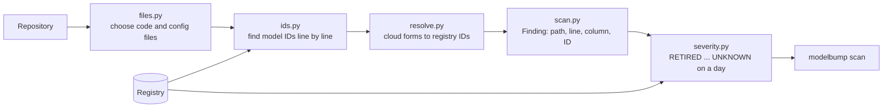

# Scanner

**Job:** answer "which LLM model IDs does this repository depend on, and where?"

**Code:** `src/modelbump/scanner/` · **Command:** `modelbump scan PATH` · **Decisions:** [ADR 0023](../adr/0023-scanner-finds-ids-as-text-first.md), [ADR 0024](../adr/0024-severity-levels-and-ci-exit-code.md)



## How an ID is recognised

Each line is split into runs of letters, digits, `.`, `-` and `_`. A run is a finding when it is:

| Rule | Example found | Example ignored |
|------|---------------|-----------------|
| An exact registry ID | `claude-3-haiku-20240307` | |
| A provider name with a digit (lowercase) | `gpt-4o`, `gemini-2.5-flash`, `o3-mini` | `gpt-tokenizer`, `GPT-4` |
| A plain-word registry ID, only when quoted | `engine="davinci"` | `Ada Lovelace` |
| The part after a provider prefix | `anthropic.claude-3-...`, `openai/gpt-4o` | `my-gpt-4o` |

Cloud forms are then mapped to the registry ID, but only when the mapped ID is in the registry: Bedrock's `claude-3-haiku-20240307-v1` becomes `claude-3-haiku-20240307`, and Vertex AI's `claude-3-5-sonnet@20240620` becomes `claude-3-5-sonnet-20240620`.

## Severity

| Level | Meaning |
|-------|---------|
| `RETIRED` | The shutdown day has passed. Calls fail now. |
| `RETIRING_SOON` | Shuts down within the warning window (`--soon-days`, 90 by default). |
| `DEPRECATED` | A shutdown is announced, further away than the window. |
| `UNKNOWN` | No retirement announced. |

`--today YYYY-MM-DD` checks as if it were that day; a model announced later than that day is `UNKNOWN`. `--fail-within N` makes the scan exit with code 1 when any finding is retired or shuts down within N days.

## Example

```console
$ modelbump scan . --fail-within 30
app/llm.py:12:39  gpt-3.5-turbo-0613  RETIRED  shut down on 2024-09-13; suggested replacement gpt-3.5-turbo
config/models.yaml:1:16  claude-sonnet-4-5  UNKNOWN  no retirement announced
Found 2 model IDs in 2 files (scanned 14 files): 1 RETIRED, 1 UNKNOWN.
Failed: 1 model ID is retired or shut down within 30 days.
```

## Files scanned

Code (`.py`, `.ipynb`, `.js`, `.ts`, `.tsx`, `.go`, `.java`, ...) and config (`.json`, `.yaml`, `.toml`, `.ini`, `.env`, `.env.example`, ...). Docs, lock files, tool folders (`.git`, `node_modules`, `.venv`, ...), symbolic links, files over 1 MB and binary files are skipped. A file named directly on the command line is always scanned.

## Not yet

- Call context from tree-sitter parsers (Python, then TypeScript).
- JSON and SARIF output, and the GitHub Action.
