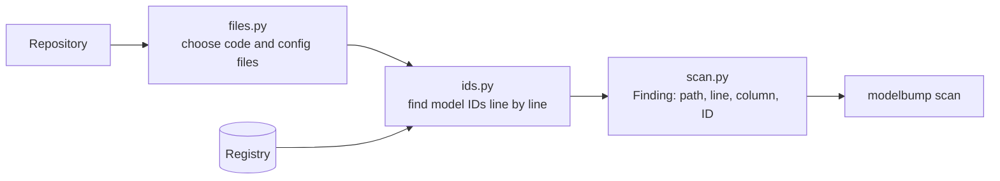

# Scanner

**Job:** answer "which LLM model IDs does this repository depend on, and where?"

**Code:** `src/modelbump/scanner/` · **Command:** `modelbump scan PATH` · **Decision:** [ADR 0023](../adr/0023-scanner-finds-ids-as-text-first.md)



## How an ID is recognised

Each line is split into runs of letters, digits, `.`, `-` and `_`. A run is a finding when it is:

| Rule | Example found | Example ignored |
|------|---------------|-----------------|
| An exact registry ID | `claude-3-haiku-20240307` | |
| A provider name with a digit (lowercase) | `gpt-4o`, `gemini-2.5-flash`, `o3-mini` | `gpt-tokenizer`, `GPT-4` |
| A plain-word registry ID, only when quoted | `engine="davinci"` | `Ada Lovelace` |
| The part after a provider prefix | `anthropic.claude-3-...`, `openai/gpt-4o` | `my-gpt-4o` |

## Example

```console
$ modelbump scan .
app/llm.py:12:39  gpt-3.5-turbo-0613  retired
config/models.yaml:1:16  claude-sonnet-4-5  not in registry
Found 2 model IDs in 2 files (scanned 14 files).
```

The status column comes from the registry on today's date. "not in registry" means no retirement has been announced for that ID.

## Files scanned

Code (`.py`, `.ipynb`, `.js`, `.ts`, `.tsx`, `.go`, `.java`, ...) and config (`.json`, `.yaml`, `.toml`, `.ini`, `.env`, `.env.example`, ...). Docs, lock files, tool folders (`.git`, `node_modules`, `.venv`, ...), symbolic links, files over 1 MB and binary files are skipped. A file named directly on the command line is always scanned.

## Not yet

- Severity levels and a failing exit code for CI.
- Provider forms such as Bedrock's `-v1:0` and Vertex's `@20240620`, mapped to the registry ID.
- Call context from tree-sitter parsers (Python, then TypeScript).
- JSON and SARIF output, and the GitHub Action.
