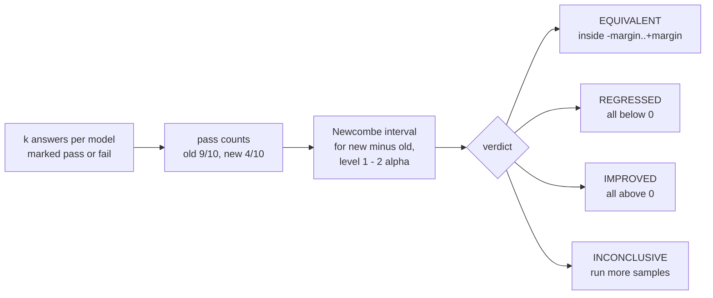

# Stats engine

**Job:** decide, from repeated answers, whether the new model is worse than the old one, and control how often that decision is wrong.

**Code:** `src/modelbump/stats/` · **Commands:** `modelbump stats item OLD NEW`, `modelbump stats simulate OLD_RATE NEW_RATE`, `modelbump stats simulate-suite` · **Decisions:** [ADR 0041](../adr/0041-item-verdict-from-pass-counts.md), [ADR 0042](../adr/0042-sequential-stopping-by-betting.md), [ADR 0043](../adr/0043-suite-control-with-e-bh.md)



## One test case

```console
$ modelbump stats item 9/10 4/10
Old model: 9/10 passed (90.0%)
New model: 4/10 passed (40.0%)
Difference (new - old): -50.0 points, 90% interval -75.8 to -7.9
Verdict: REGRESSED (the new model is worse on this test case)
```

| Option | Default | Meaning |
|--------|---------|---------|
| `--margin` | 0.1 | Largest change in pass rate that still counts as the same (0.1 = 10 points) |
| `--alpha` | 0.05 | Chance of a wrong REGRESSED, IMPROVED or EQUIVALENT claim |

How many answers are enough? Two models that pass every time:

| Answers per model | Interval | Verdict |
|-------------------|----------|---------|
| 10 | −28.5 to +28.5 points | INCONCLUSIVE |
| 50 | −6.9 to +6.9 points | EQUIVALENT |

## Stop as soon as the answer is clear

Choosing the number of answers in advance is hard: a total break shows after a few, a 10-point drop needs 180. Checking the interval above after every answer is not safe (22% false alarms instead of 5% in our simulation). So the engine asks each model once per round and keeps a "wealth" for each claim. The wealth grows when the answers go against that claim's null hypothesis, and a claim is proven when its wealth reaches 1/alpha. By Ville's inequality this is safe to check after every answer ([ADR 0042](../adr/0042-sequential-stopping-by-betting.md)).

```console
$ modelbump stats simulate 0.9 0.6
Simulated test case: old model passes 90%, new model 60% (seed 1)
Stopped early after 61 answers per model (old 55/61, new 41/61)
Verdict: REGRESSED (the new model is worse on this test case)
Evidence (a claim is proven at 20): regressed 27.2, improved 0.1, equivalent 0.1
```

| True pass rate, old → new | Mean answers per model to a verdict |
|---------------------------|-------------------------------------|
| 100% → 0% | 11 |
| 90% → 60% | 40 |
| 100% → 100% (EQUIVALENT) | 43 |
| Fixed design for a 10-point drop | 180, for every test case |

## A whole suite

With 300 test cases checked at 5% each, a new model that changed nothing still gets a few REGRESSED by chance. The engine controls the false discovery rate instead: among the test cases it calls REGRESSED, at most 5% are expected to be false alarms. Each test case stops when its wealth reaches m/q (6,000 for 300 cases), and e-BH then decides the whole suite ([ADR 0043](../adr/0043-suite-control-with-e-bh.md)).

```console
$ modelbump stats simulate-suite
Simulated suite: 300 test cases, 30 made worse by 30 points (seed 1)
REGRESSED: 30 (30 really worse, 0 false alarms)
IMPROVED: 0
EQUIVALENT: 65
INCONCLUSIVE: 205
Answers per model: 50,955 (170 per test case)
Without suite control: 5 false alarms
```

| Option | Default | Meaning |
|--------|---------|---------|
| `--items` | 300 | Test cases in the suite |
| `--regressed` | 30 | How many the new model is really worse on |
| `--drop` | 0.3 | How much pass rate those lose |
| `--fdr` | 0.05 | Largest expected share of false alarms among REGRESSED |

## From Python

```python
from modelbump.stats import Verdict, compare_scores, run_sequential, run_suite

result = compare_scores(old=[True] * 9 + [False], new=[True] * 4 + [False] * 6)
assert result.verdict is Verdict.REGRESSED

# next_round() returns (old_pass, new_pass) for one fresh answer from each model.
sequential = run_sequential(next_round, max_runs=200)
print(sequential.verdict, sequential.runs)

# A suite: test case name -> its next_round function.
suite = run_suite({"refund-policy": next_round_a, "json-schema": next_round_b}, q=0.05)
print(suite.named(Verdict.REGRESSED))
```

## Still to come in Phase 4

- A simulation study that reproduces error rates, power and savings from one command.
- Scores between 0 and 1, not only pass or fail.
- The RQ2 experiment on local model pairs, such as `ollama/qwen2.5:7b` to `ollama/qwen3:8b`.
