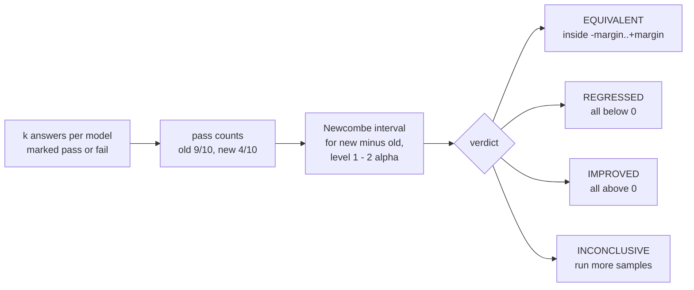

# Stats engine

**Job:** decide, from repeated answers, whether the new model is worse than the old one, and control how often that decision is wrong.

**Code:** `src/modelbump/stats/` · **Command:** `modelbump stats item OLD NEW` · **Decisions:** [ADR 0041](../adr/0041-item-verdict-from-pass-counts.md)



## One test case

```console
$ modelbump stats item 9/10 4/10
Old model: 9/10 passed (90.0%)
New model: 4/10 passed (40.0%)
Difference (new - old): -50.0 points, 90% interval -75.8 to -7.9
Verdict: REGRESSED (the new model is worse on this test case)
```

| Option | Default | Meaning |
|--------|---------|---------|
| `--margin` | 0.1 | Largest change in pass rate that still counts as the same (0.1 = 10 points) |
| `--alpha` | 0.05 | Chance of a wrong REGRESSED, IMPROVED or EQUIVALENT claim |

How many answers are enough? Two models that pass every time:

| Answers per model | Interval | Verdict |
|-------------------|----------|---------|
| 10 | −28.5 to +28.5 points | INCONCLUSIVE |
| 50 | −6.9 to +6.9 points | EQUIVALENT |

## From Python

```python
from modelbump.stats import Verdict, compare_scores

result = compare_scores(old=[True] * 9 + [False], new=[True] * 4 + [False] * 6)
assert result.verdict is Verdict.REGRESSED
print(result.difference, result.interval)
```

## Still to come in Phase 4

- Sequential sampling: stop asking as soon as the verdict is clear.
- Control across a whole suite (Benjamini–Hochberg), so 300 test cases do not give 15 false alarms.
- A simulation study that reproduces error rates, power and savings from one command.
- The RQ2 experiment on local model pairs, such as `ollama/qwen2.5:7b` to `ollama/qwen3:8b`.
