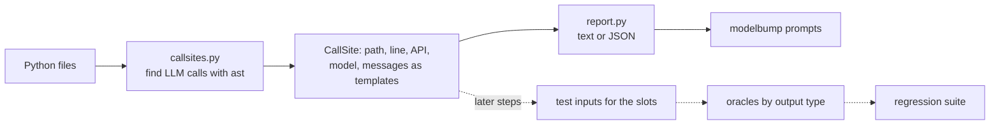

# Suite synthesizer

**Job:** turn an app's own LLM calls into regression test cases that the runner and the stats engine can compare on the old and new model.

**Code:** `src/modelbump/synth/` · **Command:** `modelbump prompts PATH` · **Decisions:** [ADR 0048](../adr/0048-find-llm-calls-and-prompt-templates.md)



Only the first box is built so far (Step P5-1). The dotted ones are the next steps of Phase 5.

## What a call site holds

| Field | Example |
|-------|---------|
| `path`, `line` | `support.py`, `24` |
| `api` | `openai_chat`, `openai_responses`, `openai_completions`, `anthropic`, `gemini`, `litellm`, `ollama`, `other` |
| `call` | `client.chat.completions.create` |
| `model` | `gpt-4o-mini` (also through `MODEL = os.getenv("M", "gpt-4o-mini")`), or empty when the file does not say |
| `parts` | one per message: role (`system`, `user`, `assistant`, `prompt`, `unknown`) and template |
| `complete` | every message was read and holds written text |

## Templates

A template is the text the code writes, in Python's format syntax: `{slot}` where the code puts in a value at run time, and `{{` for a literal brace. `render(template, values)` fills it.

| Code | Template |
|------|----------|
| `f"Ticket:\n{ticket}"` | `Ticket:\n{ticket}` |
| `"Hi {}, {who}".format(a, who=b)` | `Hi {a}, {who}` |
| `"Total %d of %s" % (n, kind)` | `Total {n} of {kind}` |
| `"Summarize: " + text` | `Summarize: {text}` |
| `f"Labels: {LABELS}"` with `LABELS = "bug, feature"` | `Labels: bug, feature` |
| `textwrap.dedent("""...""").format(...)`, `.strip()`, `"\n".join([...])` | the text after those calls |
| `prompt` (a function argument) | `{prompt}`: only a slot, so the call is partial |

Messages are read from list literals of `{"role": ..., "content": ...}` dicts, `dict(role=..., content=...)`, `("system", "...")` tuples and LangChain-style `SystemMessage(...)` / `HumanMessage(...)`, including lists built in a variable with `.append`, `.extend`, `+=`, `+` and `*`. Anthropic's `system=` and OpenAI's `instructions=` become a system message; content blocks keep their text blocks only.

## Example

```console
$ modelbump prompts tests/fixtures/prompt-demo
extract.py:9  gemini  client.models.generate_content
  model: gemini-2.0-flash
  system: "Return JSON with the keys order_id, items and total."
  user: "Email:\n{email}\n\nJSON:"
  slots: email
support.py:24  openai_chat  client.chat.completions.create
  model: gpt-4o-mini
  system: "You sort support tickets.\nAnswer with one label: bug, feature, question.\n"
  user: "Ticket:\n{ticket}"
  slots: ticket
...
Found 4 LLM calls in 2 files (read 2 Python files): 3 with all prompt text, 1 partial.
```

`--model gpt-4o-mini` keeps the calls to one model, and `--format json --output calls.json` writes the full templates.

## Limits (for now)

- Python only. TypeScript and JavaScript come later, with tree-sitter.
- Names are followed inside one file. Prompts imported from another file, passed as function arguments or kept on `self` stay slots, and the call is marked partial.
- With `if`/`else`, the last assignment before the call wins.
