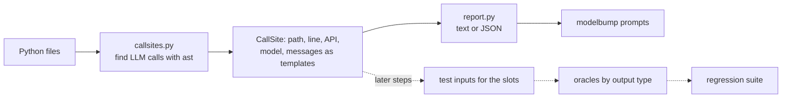

# Suite synthesizer

**Job:** turn an app's own LLM calls into regression test cases that the runner and the stats engine can compare on the old and new model.

**Code:** `src/modelbump/synth/` · **Command:** `modelbump prompts PATH` · **Decisions:** [ADR 0048](../adr/0048-find-llm-calls-and-prompt-templates.md), [ADR 0049](../adr/0049-follow-prompts-across-files-classes-and-functions.md)



Only the first box is built so far (Steps P5-1 and P5-2). The dotted ones are the next steps of Phase 5.

## What a call site holds

| Field | Example |
|-------|---------|
| `path`, `line` | `support.py`, `24` |
| `api` | `openai_chat`, `openai_responses`, `openai_completions`, `anthropic`, `gemini`, `litellm`, `ollama`, `other` |
| `call` | `client.chat.completions.create` |
| `model` | `gpt-4o-mini` (also through `MODEL = os.getenv("M", "gpt-4o-mini")`), or empty when the file does not say |
| `parts` | one per message: role (`system`, `user`, `assistant`, `prompt`, `unknown`) and template |
| `complete` | every message was read and holds written text |

## Templates

A template is the text the code writes, in Python's format syntax: `{slot}` where the code puts in a value at run time, and `{{` for a literal brace. `render(template, values)` fills it.

| Code | Template |
|------|----------|
| `f"Ticket:\n{ticket}"` | `Ticket:\n{ticket}` |
| `"Hi {}, {who}".format(a, who=b)` | `Hi {a}, {who}` |
| `"Total %d of %s" % (n, kind)` | `Total {n} of {kind}` |
| `"Summarize: " + text` | `Summarize: {text}` |
| `f"Labels: {LABELS}"` with `LABELS = "bug, feature"` | `Labels: bug, feature` |
| `textwrap.dedent("""...""").format(...)`, `.strip()`, `"\n".join([...])` | the text after those calls |
| `prompt` (a function argument) | `{prompt}`: only a slot, so the call is partial |

Messages are read from list literals of `{"role": ..., "content": ...}` dicts, `dict(role=..., content=...)`, `("system", "...")` tuples and LangChain-style `SystemMessage(...)` / `HumanMessage(...)`, including lists built in a variable with `.append`, `.extend`, `+=`, `+` and `*`. Anthropic's `system=` and OpenAI's `instructions=` become a system message; content blocks keep their text blocks only.

## Following prompts through the code

Prompts are often not written at the call. The finder follows them, in this order of where a name is looked up:

| Code | What is followed |
|------|------------------|
| `prompt = f"..."` then `create(prompt=prompt)` | The last assignment before the call in the same function, then module names |
| `from .prompts import SYSTEM`, `import app.prompts as p` then `p.SYSTEM` | Other files in the folder, by relative import, full module name, or a unique folder suffix (`app.prompts` finds `backend/src/app/prompts.py`) |
| `self.system` | Set earlier in the same method, else in `__init__`, else in the class body, else in the only other method that sets it |
| `build_prompt(question)` | A function of the app with one `return`, read with the call's arguments: `def build_prompt(q): return f"Q: {q}"` gives `Q: {question}` |
| `self.method(...)`, `Prompts.method(...)`, `family.method(...)` | Methods, through `self`, the class name, a parameter typed `family: Prompts` (or `type[Prompts]`, `Prompts \| None`), or `family = Prompts()` |
| `create(**params)` | A dict literal of keywords in the same function; keywords written in the call win |
| `[system_message] + history` | The messages it can read, plus one `unknown` part for `history` |

Following imports needs the folder: `modelbump prompts app.py` reads that one file alone. Files left out with `--exclude` or `--skip-tests` are still followed into; they are only left out of the report.

## Example

```console
$ modelbump prompts tests/fixtures/prompt-demo
bot.py:14  openai_chat  self.client.chat.completions.create
  model: gpt-4o-mini
  system: "Answer questions about our product from the FAQ. If unsure, say you don't know."
  user: "Question: {question}\nAnswer in at most 2 sentences."
  slots: question
extract.py:9  gemini  client.models.generate_content
  model: gemini-2.0-flash
  system: "Return JSON with the keys order_id, items and total."
  user: "Email:\n{email}\n\nJSON:"
  slots: email
support.py:24  openai_chat  client.chat.completions.create
  model: gpt-4o-mini
  system: "You sort support tickets.\nAnswer with one label: bug, feature, question.\n"
  user: "Ticket:\n{ticket}"
  slots: ticket
...
Found 5 LLM calls in 3 files (read 4 Python files): 4 with all prompt text, 1 partial.
```

`bot.py` takes its model, system prompt and question template from `prompts.py`. `--model gpt-4o-mini` keeps the calls to one model, and `--format json --output calls.json` writes the full templates.

## Limits (for now)

- Python only. TypeScript and JavaScript come later, with tree-sitter.
- A prompt passed into a function as an argument stays a slot in that function (`def ask(prompt): create(prompt=prompt)`); the callers of a wrapper are not followed yet.
- With `if`/`else` or `a if c else b`, the finder does not pick a branch: the last assignment before the call wins, and a conditional expression stays a slot.
- A function with more than one `return`, an object whose class has no type hint, and conversation history built at run time stay unknown.
